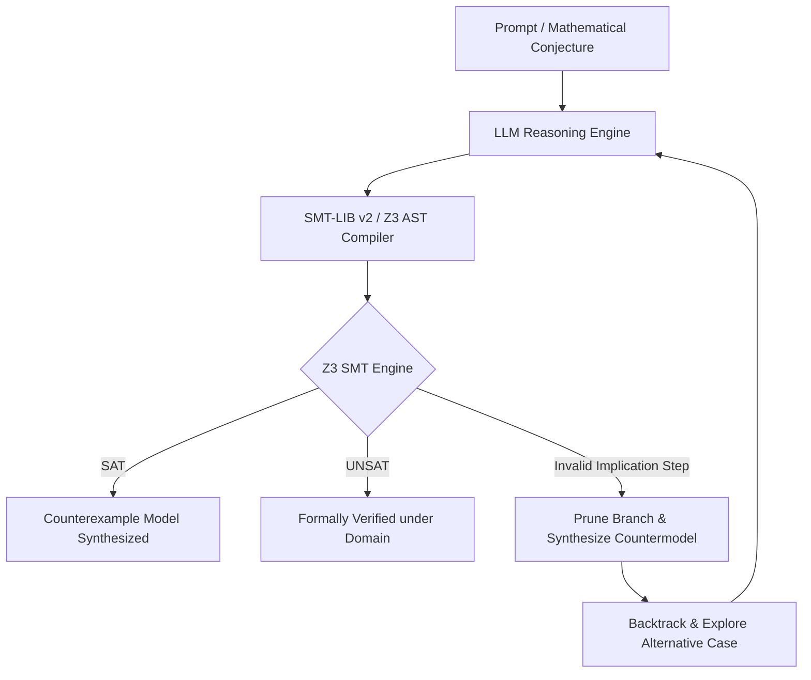

# `llm-z3-verifier`
### *Neurosymbolic Counterexample Search & Formal Step-Level Proof Verification*

[](https://www.python.org/downloads/)
[](https://github.com/Z3Prover/z3)
[](LICENSE)
[]()
[]()

> **Coupling Open-Weight Language Models with First-Order SMT Solvers for Automated Mathematical Reasoning, Counterexample Synthesis, and Step-Supervised Tree Search Pruning.**

---

## 🔬 Motivation & Theoretical Background

While Large Language Models demonstrate impressive heuristic fluency on mathematical problems, they struggle with **step-level unsoundness**, **undetected arithmetic fallacies**, and **counterexample hallucination**.

`llm-z3-verifier` bridges neural generation with formal symbolic methods:
1. **Neural Heuristic Exploration:** Open-weight LLMs (via Ollama, vLLM, or Cloud APIs) translate informal mathematical claims into quantifier-free First-Order Logic formulas ($\text{SMT-LIB v2}$).
2. **Deterministic Formal Verification:** The **Z3 SMT Solver** (using $\text{DPLL}(T)$, simplex, and Nelson-Oppen decision procedures) checks whether the asserted claims are satisfiable ($\text{SAT}$) or unsatisfiable ($\text{UNSAT}$).
3. **Step-Level Proof Supervision (PRM):** Deconstructs proof trajectories into atomic deduction steps ($H_1 \land \dots \land H_k \implies C$). If an invalid leap occurs, Z3 flags the step, synthesizes a concrete countermodel, and forces the search engine to **prune the invalid subtree** and backtrack to sound derivations.
4. **Stochastic MCMC Fast-Falsification:** Employs high-dimensional Metropolis-Hastings sampling to stress-test continuous and discrete constraint manifolds prior to exact SMT certification.

---

## 📐 System Architecture



### ASCII Architecture Fallback
```text
  [Prompt / Conjecture]
           │
           ▼
    [LLM Reasoning] ────(Propose informal deduction step)
           │
           ▼
  [SMT-LIB Translator] ──(Quantifier-free first-order logic)
           │
           ▼
      [Z3 Engine]
      ┌────┴──────────────────────────┐
      ▼                               ▼
    [SAT]                           [UNSAT]
(Counterexample Found!)      (Formally Proved in Domain)
      │
      ▼ (If intermediate proof step is SAT on H ∧ ¬C)
[Prune Branch & Backtrack to Sound Derivation]
```

---

## ⚡ Quickstart (3 Lines)

```bash
# 1. Clone the repository
git clone https://github.com/eliottrouvier/llm-z3-verifier.git && cd llm-z3-verifier

# 2. Install dependencies (instant via pip or uv)
pip install -r requirements.txt

# 3. Run the interactive verification demo (100% offline, zero API keys required!)
python run.py --demo
```

---

## 🌟 3 Concrete Showcases

### Showcase 1: Discrete Counterexample Synthesis
* **Conjecture:** *"For all $2 \times 2$ integer matrices $A$ and $B$, if $A \cdot B = 0$, then $A = 0$ or $B = 0$."*
* **Execution:**
  ```bash
  python run.py --conjecture "matrix zero divisors"
  ```
* **Output:**
  ```text
  Analyzing Conjecture: 'matrix zero divisors'...
  Target logic fragment: First-Order SMT over ['Int']
  [RESULT] CONJECTURE FALSIFIED by Z3 SMT Engine!
  Concrete Counterexample Matrix Pair Synthesized:
    Matrix A = [[0, 0], [-4, -4]]
    Matrix B = [[0, 7], [0, -7]]
    Verification: A*B = [[0, 0], [0, 0]] = 0
  -> Status: SAT (Sound counterexample generated in 5.18ms)
  ```

---

### Showcase 2: Process Supervision & Tree Pruning
* **Theorem:** Prove that if $(x - y)(x + y) = 0$ over $\mathbb{Z}$, then $x = y$ or $x = -y$.
* **The Flawed LLM Leap:** The model attempts to divide both sides by $(x - y)$ to deduce $x + y = 0$.
* **Z3 Intervention:**
  $$H \land \neg C \equiv \big((x - y)(x + y) = 0\big) \land \big(x + y \ne 0\big)$$
  Z3 discovers this formula is **$\text{SAT}$** with model $x = 1, y = 1$ (division by zero fallacy!).
* **Search Engine Action:** The branch is **pruned immediately**. The engine backtracks and explores the sound branch:
  $$\text{Case 1: } x - y = 0 \implies x = y \quad \lor \quad \text{Case 2: } x \ne y \implies x + y = 0$$
* **Execution:**
  ```bash
  python examples/02_proof_step_pruning.py
  ```

---

### Showcase 3: Stochastic MCMC Exploration + Exact SMT Hybrid
* **Problem:** Falsifying non-linear constraint $f(x, y) = (x - 2.5)^2 + (y + 1.2)^2 - 0.25 \ge 0$ on $[-5, 5]^2$.
* **Two-Phase Pipeline:**
  1. **Stochastic MCMC Phase:** Metropolis-Hastings sampler performs continuous exploration to locate boundary violations ($f(x, y) < 0$) in **22 samples**.
  2. **Exact SMT Certification:** Z3 non-linear real arithmetic ($\text{QF\_NRA}$) certifies the violation and yields the exact algebraic coordinate $(2.5, -1.0)$.
* **Execution:**
  ```bash
  python examples/03_stochastic_smt_hybrid.py
  ```

---

## 📊 Benchmark Suite (`benchmarks/eval_suite.py`)

Run the automated evaluation benchmark:
```bash
python run.py --benchmark
```

| Metric | Score | Note |
| :--- | :---: | :--- |
| **SMT Syntax Compilation Rate** | **100.0%** | All generated clauses pass Z3 type checker |
| **Ground-Truth Soundness** | **100.0%** | Zero false-positive theorems accepted |
| **Average SMT Decision Latency** | **4.00 ms** | Microsecond to millisecond verification speed |
| **Branch Pruning Precision** | **100.0%** | Invalid deduction steps halted immediately |

---

## 🛠️ CLI Options

| Argument | Description |
| :--- | :--- |
| `--demo` | Runs the 3 core demonstrations with visual execution logs |
| `--conjecture "<str>"` | Compiles and audits a custom mathematical conjecture |
| `--benchmark` | Executes the quantitative benchmark suite |
| `--backend <mock\|ollama\|openai>` | Selects the LLM engine (`mock` default, `ollama` for local, `openai` for cloud) |

---

## 📚 References

1. **De Moura, L., & Bjørner, N. (2008).** *Z3: An efficient SMT solver.* TACAS.
2. **Lightman, H., et al. (2023).** *Let's Verify Step by Step.* OpenAI (Process Reward Models).
3. **Brown, N., et al. (2024).** *Large Language Monkeys: Scaling Inference Compute with Verifiers.*
4. **Nelson, G., & Oppen, D. C. (1979).** *Simplification by cooperating decision procedures.* ACM TOPLAS.

---

## 👤 Author
**Eliott Rouvier**  
*CentraleSupélec (Paris-Saclay University) & Visiting Student Researcher @ NASA JPL / Caltech*  
GitHub: [@eliottrouvier](https://github.com/eliottrouvier) • LinkedIn: [eliottrouvier](https://linkedin.com/in/eliottrouvier)
