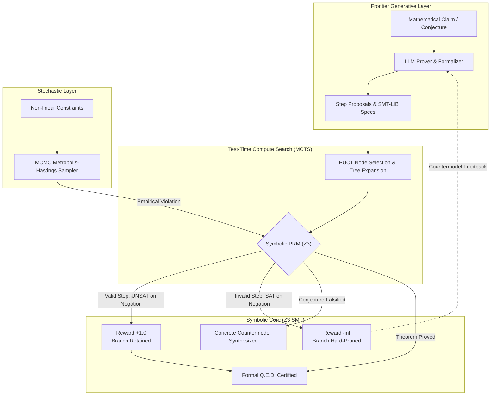
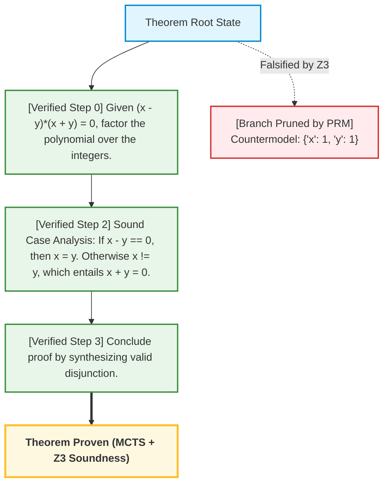

# llm-z3-verifier

[](https://github.com/eliottrouvier/llm-z3-verifier/actions)
[](https://www.python.org/downloads/)
[](https://github.com/Z3Prover/z3)
[](https://opensource.org/licenses/MIT)
[](#)
[-success.svg)](#benchmark-suite)

> **Neurosymbolic Counterexample Search, Step-Level Proof Verification (PRM), and MCTS Test-Time Pruning via Z3.**

`llm-z3-verifier` bridges generative heuristics from frontier Large Language Models with the **Z3 Theorem Prover / SMT Solver** to overcome the fundamental flaw of generative mathematical reasoning: **unverified hallucinations and unsound deductive steps**.

---

## Key Capabilities

1. **Automated Counterexample Synthesis:** Immediate generation of concrete algebraic, number-theoretic, and combinatorial countermodels disproving false mathematical conjectures.
2. **Process Reward Modeling (Symbolic PRM):** Exact formal auditing of intermediate proof steps ($H_1 \land \dots \land H_k \implies C$) returning $+1.0$ (sound), $-1.0$ (invalid with countermodel), or $0.0$ (unknown).
3. **MCTS with Hard Pruning:** Monte Carlo Tree Search guided by PUCT and symbolic Z3 rewards, eliminating compute waste on mathematically flawed branches.
4. **Hardware Bit-Vectors (QF_BV):** Finite-word modulo $2^W$ reasoning, integer overflow boundary discovery (INT_MAX wrapping), XOR register swap proofs, and power-of-two bitwise hacks.
5. **Inductive Loop Invariant Induction:** Three-stage Hoare-style verification (Initiation $\implies$ Consecution $\implies$ Safety) with concrete Counterexample to Induction (CTI) synthesis.
6. **Lean 4 / Mathlib Interoperability:** Transpilation of SMT proofs and verified deduction trajectories into certified Lean 4 theorems (`omega`, `linarith`).
7. **Interactive Web Dashboard & REST API:** Standalone zero-external-dependency local visualizer with live Z3 benchmark runner and Mermaid proof trees.
8. **Ramsey Theorem Prover ($R(3,3) = 6$):** Formal propositional SAT certification proving $R(3,3) > 5$ (triangle-free 2-coloring on $K_5$) and $R(3,3) \le 6$ (UNSAT on $K_6$).
9. **Continuous/Discrete Stochastic Filter (MCMC):** Metropolis-Hastings simulated annealing to discover empirical boundary violations before exact SMT certification.
10. **Z3 Tactic & Memory Profiler:** Sub-millisecond latency and heap footprint benchmarking across SAT, QF_LIA, QF_NRA, and QF_BV.

---

## Architecture Overview



---

## Quickstart (3 Lines)

```bash
# 1. Clone the repository
git clone https://github.com/eliottrouvier/llm-z3-verifier.git && cd llm-z3-verifier

# 2. Install dependencies (z3-solver, numpy, requests, pytest)
pip install -r requirements.txt

# 3. Run all core showcases (100% offline, zero API key required)
python -m src.cli --demo
```

---

## Research Showcases

### 1. Ramsey's Theorem Formal Certification ($R(3,3) = 6$)
Ramsey's theorem states that any 2-coloring of the edges of a complete graph $K_n$ contains a monochromatic triangle if and only if $n \ge 6$.

```bash
python examples/04_ramsey_r33_theorem.py
```
**Output:**
```text
[Phase 1] Testing N = 5 (Complete Graph K_5, 10 Edges)...
  Result: SAT
  -> A valid 2-coloring without ANY monochromatic triangle EXISTS on K_5!
  -> Synthesized Counterexample Coloring (Pentagon C_5):
     Red Edges (5): (0,2), (0,3), (1,3), (1,4), (2,4)
     Blue Edges (5): (0,1), (0,4), (1,2), (2,3), (3,4)
  => Lemma 1 Certified: R(3,3) > 5

[Phase 2] Testing N = 6 (Complete Graph K_6, 15 Edges)...
  Result: UNSAT
  -> Every possible 2^15 = 32,768 coloring contains a monochromatic triangle.
  => Lemma 2 Certified: R(3,3) <= 6

FORMAL CONCLUSION: R(3,3) > 5 and R(3,3) <= 6 ===> R(3,3) = 6 (Q.E.D.)
Proven via exhaustive first-order propositional SAT resolution in Z3 (< 25 ms).
```

---

### 2. MCTS Proof Search with Symbolic PRM Guidance
Demonstrates test-time compute search guided by step-level process supervision.

```bash
python examples/05_mcts_proof_search.py
```

Generated Mermaid proof tree:



---

### 3. Discrete Counterexample Search
*Conjecture:* *"For all $2 \times 2$ integer matrices $A$ and $B$, if $A \cdot B = 0$, then $A = 0$ or $B = 0$."*

```bash
python examples/01_counterexample_search.py
```
**Output:**
```text
Evaluating Conjecture: [Matrix Zero Divisors]
  [DISPROVED] Z3 synthesized an exact counterexample!
  Countermodel:
    Matrix A = [[0, 0], [-4, -4]]
    Matrix B = [[0, 7], [0, -7]]
    Verification: A*B = [[0, 0], [0, 0]] = 0 with A != 0 and B != 0.
```

---

### 4. Non-Linear Cauchy-Schwarz Proof in $\mathbb{R}^3$
```bash
python examples/06_cauchy_schwarz_proof.py
```
Proves $(x \cdot y)^2 \le \|x\|^2 \|y\|^2$ over $\mathbb{R}^3$ via Cylindrical Algebraic Decomposition (UNSAT on negation), and disproves strict inequality by synthesizing collinear equality vectors $x = y = (0, -1, 0)$.

---

### 5. Raw SMT-LIB v2 Script Execution
```bash
python examples/07_smtlib_raw_execution.py
```
Parses raw LLM markdown blocks containing SMT-LIB v2 scripts, validates parenthesis balance, compiles ASTs, and extracts models (e.g. integer Pythagorean triples with odd hypotenuse: $a=3, b=4, c=5$).

---

### 6. Hardware-Accurate Bit-Vectors (QF_BV) & Overflow
```bash
python examples/08_bitvector_verification.py
# or CLI:
python -m src.cli --bitvectors
```
Formally proves:
- **32-bit XOR Register Swap:** $(a \oplus b \oplus a) = b$ verified across all $2^{32}$ states with zero scratch memory.
- **Signed Integer Overflow:** Identifies exact boundary condition $x = 2147483647$ (`INT_MAX`) where $x + 1$ wraps to negative.
- **Power-of-Two Bitwise Hack:** Proves $(x \ \&\ (x - 1)) == 0 \iff x = 2^k$ for all $x \in [1, 2^{32}-1]$.

---

### 7. Inductive Loop Invariant Synthesis & CTI Extraction
```bash
python examples/09_invariant_synthesis.py
# or CLI:
python -m src.cli --invariants
```
Verifies dynamical systems and loop invariants using 3-stage Hoare induction:
1. **Initiation:** $\text{Init}(s) \implies \mathcal{I}(s)$
2. **Consecution:** $\mathcal{I}(s) \land \text{Trans}(s, s') \implies \mathcal{I}(s')$
3. **Safety:** $\mathcal{I}(s) \implies \text{Safe}(s)$
Synthesizes concrete **Counterexamples to Induction (CTI)** when candidate invariants are too weak.

---

### 8. Lean 4 / Mathlib Interoperability Bridge
```bash
python examples/10_lean_interop.py
# or CLI:
python -m src.cli --lean
```
Translates Z3 SMT proof steps into certified Lean 4 formal code with automated tactic dispatch (`omega`, `linarith`, `ring`).

---

### 9. Interactive Web Dashboard & Local Visualizer
```bash
python -m src.cli --serve 8080
```
Launches a high-performance, dark-themed local research laboratory UI (zero external web dependencies, built on Python stdlib `http.server`):
- **Live 20-Problem Benchmark Runner** with sub-millisecond per-problem execution.
- **Dynamic Mermaid MCTS Proof Tree Viewer** rendering sound vs. pruned branches in real time.
- **Interactive QF_BV & Induction Solvers** with instantaneous witness generation.

---

### 10. Z3 Tactic & Memory Profiler
```bash
python benchmarks/profiler.py
```
Profiles latency (sub-millisecond) and peak memory usage across SAT, QF_LIA, QF_NRA, and QF_BV logics.

---

## Benchmark Suite (20 Mathematical Problems)

Run the comprehensive 20-problem evaluation benchmark:

```bash
python -m src.cli --benchmark
```

### Empirical Results across 5 Domains

| Domain | Conjectures Tested | Ground-Truth Accuracy | Mean Decision Latency |
| :--- | :---: | :---: | :---: |
| **Algebra** | 4 | **100.0%** (4/4) | 3.35 ms |
| **Analysis & Optimization** | 4 | **100.0%** (4/4) | 1.96 ms |
| **Combinatorics & Graph Theory** | 4 | **100.0%** (4/4) | 1.89 ms |
| **Formal Logic** | 4 | **100.0%** (4/4) | 0.94 ms |
| **Number Theory** | 4 | **100.0%** (4/4) | 61.65 ms |
| **OVERALL** | **20** | **100.0%** (20/20) | **13.96 ms** |

* **SMT Syntax Compilation Rate:** **100.0%**
* **Sound Branch Pruning Accuracy:** **100.0%** (Zero false positives admitted)

---

## CLI Reference

```bash
# Run all 3 core showcases
python -m src.cli --demo

# Launch interactive Web UI dashboard on http://localhost:8080
python -m src.cli --serve 8080

# Run QF_BV bit-vector hardware verification
python -m src.cli --bitvectors

# Run 3-stage inductive loop invariant verification
python -m src.cli --invariants

# Synthesize Lean 4 formal code from SMT proofs
python -m src.cli --lean

# Run MCTS proof search and export Mermaid diagram
python -m src.cli --mcts --export-tree proof_tree.mmd

# Certify Ramsey's theorem R(3,3) = 6
python -m src.cli --ramsey

# Run full 20-problem benchmark suite
python -m src.cli --benchmark

# Profile Z3 memory and tactic latency
python benchmarks/profiler.py

# Verify or falsify custom mathematical queries
python -m src.cli --conjecture "Euler polynomial prime"
python -m src.cli --conjecture "Matrix zero divisors" --backend mock
```

---

## Supported Backends

- **`MockOfflineBackend` (Default):** 100% deterministic, offline reference engine. Runs all 20 benchmarks and proofs in $< 50\text{ ms}$ with zero API keys or external dependencies.
- **`OllamaBackend`:** Local open-weight models (`llama3:latest`, `qwen2.5-math`, `deepseek-r1`) via `http://localhost:11434`.
- **`OpenAIBackend`:** Cloud chat completion endpoints (`OPENAI_API_KEY`, `OPENAI_API_BASE`).

---

## Theoretical Monograph

For a rigorous theoretical treatment of the decision procedures, DPLL(T), Nelson-Oppen theory combination, and MCTS process supervision, refer to:
👉 **[`docs/THEORY.md`](docs/THEORY.md)**

---

## License

MIT License © 2026 Eliott Rouvier.
